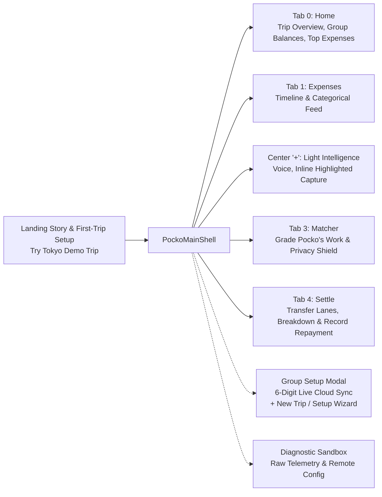
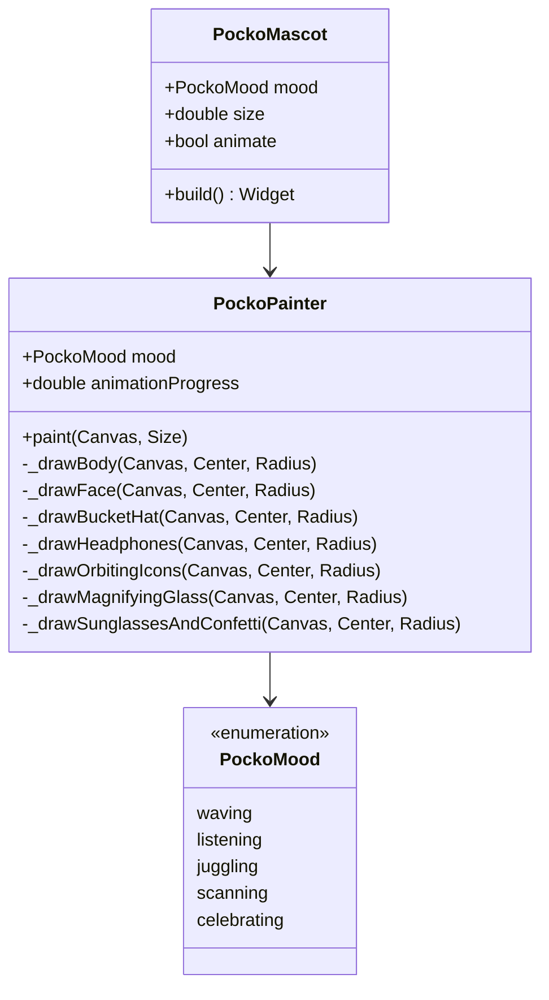

# Pocko • Comprehensive Product & Engineering Blueprint
> **The Official Architecture Specification, Design System & Devpost Pitch for #BuildHybridAI 2026**

---

## 📑 Table of Contents
1. [Product Concept & Complete User Journey](#1-product-concept--complete-user-journey)
2. ["Light Intelligence" Capture Architecture](#2-light-intelligence-capture-architecture)
3. [Google Material 3 Expressive Design System](#3-google-material-3-expressive-design-system)
4. [Vector Mascot Engineering: The "Pocko" Character System](#4-vector-mascot-engineering-the-pocko-character-system)
5. [Prompt Engineering & The 12 Travel Categories](#5-prompt-engineering--the-12-travel-categories)
6. [Mathematical Debt Simplification Algorithm ($O(N \log N)$)](#6-mathematical-debt-simplification-algorithm-on-log-n)
7. [Hybrid AI Runtime Contract & Honest Telemetry](#7-hybrid-ai-runtime-contract--honest-telemetry)
8. [Official Devpost Submission Guide](#8-official-devpost-submission-guide)

---

## 1. Product Concept & Complete User Journey

Pocko is structured around **4 core navigation tabs**, a persistent **Frosted Glass Navigation Shell** (a floating bottom bar on phones, a vertical frosted rail with the center `+` on tablets and desktop, `width >= 768`), a **Trip Setup Modal**, and a centralized **"Light Intelligence" Capture Overlay**. Every number on every screen is derived from one Riverpod `TripState`, so adding/editing/deleting an expense, changing members, switching currency, confirming slips or marking a transfer settled recalculates totals, rings, balances and badges everywhere at once.



### 🚀 Landing Story & First-Trip Setup (`lib/features/onboarding/`)
Shown on every cold start by `OnboardingGate` (the app has no stored trip yet), with a soft cross-fade / scale into the live app. The same flow opens from **Manage Group ➔ New Trip / Setup Wizard** (straight on the setup card).

1. **Illustrated 3-scene story** (`OnboardingScreen` + [`story_scenes.dart`](../lib/features/onboarding/story_scenes.dart)): a swipeable `PageView` where each page leads with an animated, painted scene (`CustomPainter` + layered cards, one looping clock, **no blur filters**) starring a large Pocko, then an entrance-animated headline and feature chips. Dots, **Next** / **Skip**.
   * **Speak offline in 3s** (*Log live while traveling*): a striped café awning, string lights and a steaming ramen bowl; an **Offline** chip, a speech bubble whose waveform turns into the typed bill (`Ramen 1,200 yen with Maya`) and a `✓ Logged in 3s` confirmation, with a listening Pocko.
   * **Slips snap onto expenses** (*Smart transfer slip matching*): three waiting expense cards, and a perforated bank slip (`TRANSFER ¥800 •••• 4829`) flies in along a dashed path, docks beside the Taxi card with a ring pulse and flips it from *Waiting for slip* to *Matched*, with a scanning Pocko.
   * **Your card numbers stay yours** (*On-device privacy shield*): a card whose digits are masked group by group by a scan beam (`•••• •••• •••• 4829`), a pulsing emerald shield with a check, a *Syncs •••• 4829 only* chip and a waving Pocko.
2. **Interactive first-trip setup** (`FirstTripSetupCard`):
   * **Trip Name** (hint `Seoul Autumn Trip`).
   * **Destination** (Pocko-styled selector): Japan ¥ JPY, South Korea ₩ KRW, Europe € EUR, United States $ USD, United Kingdom £ GBP, Thailand ฿ THB and more. Choosing one **automatically pairs the trip currency**; both the trip currency and the **home currency** (used for the secondary "≈" amounts, `Trip.homeCurrency`) can be overridden.
   * **Group members** as simple name tags (duplicates and "You" rejected, tags removable) with the micro-copy *"No app install needed for friends"*.
   * **Start Trip** calls `TripController.startNewTrip(...)`: an empty live `Trip` with its own group code, then a smooth transition into `TripHomeScreen` (the shell jumps to Home whenever the trip id changes).
3. **Try Tokyo Demo Trip:** a 1-tap shortcut on every landing page (and in Manage Group) calls `TripController.loadDemoTrip()` so hackathon judges can test a fresh setup *or* the pre-loaded demo data in one click.

**Real-device behaviour (verified on a Galaxy S22+):**
* **Keyboard-aware landing:** while the soft keyboard is open (`MediaQuery.viewInsets.bottom > 0`) the footer (dots, *Next*, *Try Tokyo Demo Trip*) is hidden instead of floating above the keyboard, so the setup form keeps the room.
* **Flags in the destination picker:** each destination carries its country flag (`🇯🇵 Japan (¥ JPY)`, `🇰🇷 South Korea (₩ KRW)`, `🇪🇺 Europe (€ EUR)`, plus Taiwan `TWD` and Hong Kong `HKD`).
* **Smooth tab switches:** the four tabs live in an `IndexedStack`; each is wrapped in `RepaintBoundary` and `TickerMode(enabled: isCurrentTab)`, so hidden tabs run no mascot / count-up tickers, and the cards, the donut and the expense list repaint independently (still zero `BackdropFilter`).

### 🏠 Tab 0: Home (`TripHomeScreen`)
* **Trip Summary Hero Card:** A mint-to-sky card with an animated, tabular total (e.g. `¥56,700`), the live USD conversion (`~$378 USD`), live **Per person** and **Still owed** chips, an always-fresh date range computed from the real expense dates, and a Pocko whose mood reflects the trip (napping when empty, celebrating when everyone is square).
* **Interactive Group Net Balance Row** (`SquadBalanceCard`, titled *Group Net Balance*): circular avatar orbs for all members with balance rings that include recorded settlements:
  - 🟢 **Emerald Ring (`#10B981`)**: Member is owed money.
  - 🔴 **Coral Ring (`#FF7A6B`)**: Member owes money.
  - ⚪ Grey: square. Tapping `+ Group` opens *Manage Group* (Edit Group / Invite).
* **No banners:** the old "slips ready to auto-match" and "transfers settle all debts" banners are gone. The pending-slip count is now a crisp notification badge anchored to the **top-right corner of the Matcher icon itself** (the 22 px glyph is wrapped in its own `Stack(clipBehavior: Clip.none)` and the badge uses `Positioned(top: -5, right: -8)`) in the bottom bar *and* the tablet side rail (emerald when everything is a clean match, coral when something needs review; hidden at 0).
* **Top Expenses card:** the three highest-value expenses (converted to the base currency) as horizontal rounded progress tubes sized relative to #1. Each row shows the category icon, `Title • Nov 14` and the formatted amount. It adapts to 0, 1 or 2 expenses without placeholder rows.
* **Recent Expenses Preview:** The 3 *newest* expenses with category icons, payers and amounts, plus a Pocko empty state with a call to action when the trip is empty.
* **Wide screens:** two balanced columns (hero + group on the left, Top Expenses + recent on the right).
* **Pocko sizes:** `PockoSizes` keeps the mascot large and responsive: **96-112 px** in every tab header (Home, Expenses, Matcher, Settle, Group) and **140-160 px** in empty and celebration states, never overflowing a 320 px phone. Settle now has its own mint header (*Settle up* + a live transfer count).
* **Navigation indicator:** a single pill slides between the four tabs (`AnimatedPositioned`, 260 ms, `Curves.easeOutCubic`) instead of rebuilding keyed widgets, so there is no flicker.

### 📜 Tab 1: Expenses Timeline (`ExpensesCanvasScreen`)
* **Horizontal date filter strip:** `All Dates`, `Pre-Trip` (expenses logged before the trip start date, e.g. advance insurance) and one chip per trip day. The selected filter's total is shown above the list and combines with the category filter.
* **Categorical Filter Chips with counts** (`Transport (2)`): `showCheckmark: false` on every chip, so the category icon never disappears when selected. Only categories that exist are shown; a filter whose last expense disappears is cleared automatically.
* **Date-grouped feed** (`TODAY`, `YESTERDAY`, `MON, NOV 14`), newest first, with staggered entrance animations. Every expense stores date **and time**; cards show a subtle time, the category icon, payer, tabular amount with USD secondary line, avatar stack, per-person cost, slip status (incl. *Paid in cash*) and a compact telemetry footer (`🟢 (Local) • 92ms`, `☁️ (Cloud) • 480ms`, `(Sim) • 48ms`, `✏️ (Manual)`).
* **Tap to edit:** the shared `ExpenseEditorSheet`, redesigned. Sections run top to bottom in this fixed order: **Title, Amount (currency pill prefix), Date & Time, Category, Paid By, Receipt Photo, Equal Split / Custom (stadium pill member buttons), Note, Original Voice Prompt** (last, only when present). Details: the **currency is a pill inside the Amount field**; date and time are Pocko pills that open **emerald-themed** `showDatePicker` / `showTimePicker` (any date, including pre-trip); **Category** and **Paid By** are searchable `PockoSelector` dropdowns; the split section has an **Equal Split / Custom Amounts** toggle (custom mode shows one exact amount per person, pre-filled from the equal share or from the saved `customSplits`, and the total is their sum); an **Original Voice / Text Prompt** box keeps the verbatim words; and a **Receipt / Slip Photo** slot (`PhotoAttachmentField`: *Take Photo* via the camera, *Choose from Gallery*, preview, pinch-zoom full screen, remove). Photos are picked through the injectable `ReceiptPhotoService` (longest side 900 px, JPEG quality 55, rejected above ~450 K base64 characters) and stored as `Expense.receiptImageBase64`; if a trip document would exceed the 1 MiB Firestore limit the biggest photos are left out of the *cloud copy only* (`SquadSyncService.fitImagesToDocument`) and every device keeps its own. Validation and a delete button as before. Camera / photo permissions are declared in `Info.plist` (`NSCameraUsageDescription`, `NSPhotoLibraryUsageDescription`) and the Android manifest (`IMAGE_CAPTURE` query). All sheets in the app open through `showPockoBottomSheet` (see below).
* **Unequal splits (`Expense.customSplits`):** a bill with per-person prices stores `{memberId: amount}`; `ExpenseItem.shareFractions` turns it into fractions that always sum to 1 (equal shares when absent, scaled if an edit changed the total), and `DebtSimplifier` / `computePairBreakdown` use them, so each person owes exactly their own dish.
* **Host & guest permissions (`TripPermissions`):** the device that creates a trip is its **Host** (`Trip.hostUid`, the Firebase anonymous uid); every expense and repayment records `createdByUid`. The Host edits or deletes anything, removes travelers and can **Lock Guest Edits**; guests can add entries and edit or delete only their own (nothing while the lock is on) and otherwise get *"Only the Trip Host or creator can delete this entry"*. Trips from before host tracking (`hostUid == null`) stay open to everyone. Manage Group shows a *👑 Host* badge and the lock switch (host only).
* **Pocko auto-category assist (Manual Expense):** in the Add flow the **Title** field is watched with a **2.5 s idle debounce** (`kCategoryAssistDebounce`). When it fires and you have not picked a category yourself, a lightweight local classifier (`ExpenseCategory.fromString`) selects the best chip and a tiny Pocko badge (*"Pocko suggested Meals"*, with a gentle elastic bounce) appears beside the CATEGORY header. A hand-picked category locks the field for good, an unrecognized title stays quiet, and editing an existing expense never changes its category.
* **Swipe to delete with Undo:** a floating snack bar restores the expense in one tap.
* **Empty states:** Pocko napping (no expenses) or waving (empty filter) with a one-tap fix.
* **Wide screens:** summary + filters on the left, the feed on the right.

### 🛡️ Tab 3: Smart Slip Matcher (`SmartSlipMatcherScreen`)
* **Genuinely interactive:** *Upload Slip Photo* (image picker) or *Sample Slips* (four curated demos):

  | Sample | Route | Demonstrates |
  |---|---|---|
  | Card alert • TeamLab | 🟢 On-device | PII masking + **exact match** to the TeamLab expense |
  | Bank notice • Unknown shop | 🟢 On-device | **Manual verification required** (link to an expense or create one) |
  | Paris bistro receipt (EUR) | ☁️ Cloud fallback | Itemized foreign receipt, 5 line items, FX conversion to the base currency |
  | Seoul night-market (KRW) | ☁️ Cloud fallback | Faded paper slip, 4 street-food lines |

* **Pipeline (`SlipAnalyzer`)**: `PiiMasker` masks card/account numbers, IBANs, e-mails, phone numbers and holder names on-device ➔ `HybridAiService.parseReceipt` (plain notifications stay local; itemized or foreign receipts and photos use the cloud fallback; **only masked text can leave the device**) ➔ `SlipMatcher` scores amount (FX-aware), merchant similarity and timing.
* **Match tiers:** `Exact match` (>= 90%), `Potential match` (60-89%), `Manual verification required` (no confident match).
* **"Grade Pocko's work" pair cards:** each logged expense is shown side by side with its candidate slip thumbnail (the real photo when uploaded, a painted receipt otherwise).
  - **✓ Correct** verifies the pair at once. **✕ Wrong** opens a sheet: pick another detected slip, *Choose from gallery*, run a sample slip, or **Paid in Cash (No Slip Needed)** (the expense becomes `SlipStatus.cash` and leaves the queue).
  - Expenses without any candidate wait in *Waiting for a slip* with **Choose slip** / **Paid in Cash**.
  - Slip-only cards still offer *Link to expense* and *Create expense* (opens the editor, logs it already verified).
  - Every card ends with a compact telemetry badge: `🟢 (Local) • 92ms`, `☁️ (Cloud) • 640ms` or `(Sim) • 48ms` when the offline engine answered. The collapsible "N private fields masked on-device" panel shows the masked text.
  - `Batch Confirm & Split (N)` verifies every proposed pair; verified slips collapse into a history list.
* Photos use the multimodal cloud route; when no runtime is reachable a clearly labelled (`SIM`) demonstration extraction is used. Slips are never uploaded to the group, only the matched status of the expense syncs.

### 🍩 Tab 4: Visual Settle (`VisualSettleScreen`)
* **Interactive Donut Chart (`fl_chart`):** category shares in the *base currency* (mixed-currency trips convert correctly); tap a slice or legend pill to focus it (center shows icon, %, amount).
* **Your Itemized Breakdown:** one tile per person you share money with. Expanding a tile lists every expense behind the number (who paid, the exact per-item share, both directions) and the net after N items, plus recorded payments; if a transfer is pending for that pair it offers *Mark Settled • ¥amount* right there (this one-tap shortcut records the full amount without opening the sheet). The math lives in `pair_breakdown.dart` and is covered by `settle_graph_and_breakdown_test`.
* **Net Balance Snapshot:** zero-centered animated diverging bars with tabular amounts, always reflecting outstanding balances.
* **Optimized Settlement Transfers (`TransferLaneCard`):** greedy minimal transfers drawn as **directional lanes**: a coral debtor badge, an animated emerald arrow carrying the amount pill, and an emerald creditor badge (the arrow sweeps once when the card appears; nothing loops). *Why this amount?* expands the pair's itemized breakdown; **Record Payment** opens the repayment sheet pre-filled from that lane. The old "How to pay" section was removed.
* **Record Repayment (`showRepaymentSheet`):** the **+ Record Repayment** button (and every lane) opens a sheet with *who paid whom*, amount with a currency pill, date, note and an optional **transfer slip photo**. It stores a `SettlementPayment` (`note`, `slipImageBase64`, `createdByUid` added) in `TripState.settlements`, which is the repayments list: it is deducted from every net balance, ring and chart at once, synced, and listed under **Repayment History** (*"Maya paid back You • ¥2,500"*, slip viewer, **Undo** for the creator or the Host). Invalid input (same person, no amount, unknown member) is rejected by `TripController.recordRepayment`.
* **All square:** a celebratory Pocko card with *Reset Settle Status*.

### 👥 Group Setup Modal (`SquadSetupScreen`)
* **Per-install 6-digit Group Code (e.g. `782-901`):** generated randomly so unrelated devices never share a Firestore document; input accepts `782901`, `782 901` or `782-901`.
* **Live Multi-Device Pairing:** `Join Group` (*Join Group by Code*) connects via Firestore real-time listeners. The joiner becomes a new traveler (devices never share an identity); another device's "You" is displayed as "Host".
* **Honest sync status:** `Live • Firestore multi-device sync`, `Connecting to group…` or `Offline-first • local only` (shown when Firebase is not configured). The same dot appears in the app bar.
* **Safe member management:** duplicate names are rejected; a traveler who paid for expenses (or has recorded settlements) cannot be removed; removing someone strips them from every split.
* **Live trip parameter cards:** Per-person cost, base currency picker (12 currencies, converted at approximate travel rates) and an AI Matcher toggle.

---

## 2. "Light Intelligence" Capture Architecture

The center `+` raises the **Light Intelligence overlay** ([`ai_expense_capture_sheet.dart`](../lib/features/capture/ai_expense_capture_sheet.dart)), hosted *inline* by `PockoMainShell` through [`CaptureOverlayHost`](../lib/features/capture/capture_overlay_host.dart). There is **no blur filter anywhere in the capture flow** (animating a full-screen Gaussian blur drops frames). The "dim & drop" transition only animates opacity and a transform, both composited on the GPU:

* the live page stays **full-bleed at 1.0×** (no scale transform, no rounded clip inset, so no black frame appears at the screen edges),
* a clean dark scrim (`Color(0xD9070F18)`, **~85%**, 240 ms, `Curves.easeOutCubic`) fades in over it, so the page stays recognizable but foreground text and pills have crisp contrast,
* the capture UI fades in on top; closing reverses everything and unmounts the overlay.

```mermaid
sequenceDiagram
    autonumber
    actor User
    participant Host as CaptureOverlayHost (in PockoMainShell)
    participant Overlay as Light Intelligence Overlay
    participant Speech as Speech-To-Text (or demo dictation)
    participant Gate as LiveInferenceGate
    participant HybridAI as HybridAiService
    participant Local as LocalExpenseParser (labelled SIM)
    participant Store as TripController & Firestore

    User->>Host: Taps Center '+'
    Host->>Host: ~85% dark scrim fades in over the full-bleed page (no blur, no scale)
    Host->>Overlay: Pocko zooms 0.55 -> 1.0 (240px hero)
    User->>Speech: Speaks (green gradient sweeps over the live text) or types
    User->>Overlay: Tags group members on the always-visible strip
    Speech->>Overlay: ~3.5s of dead air auto-confirms (or Confirm / Stop)
    Overlay->>Overlay: Pocko juggles, the words shimmer and wave
    Overlay->>HybridAI: parseExpenseText(text, members, currency)
    HybridAI->>Gate: probe (<= 450ms, cached 30s)
    alt Firebase AI Logic configured or on-device model ready
        Gate->>HybridAI: call runs directly (20s ceiling)
    else Nothing provisioned
        Gate-->>HybridAI: null at once
        HybridAI->>Local: instant local parse
    end
    HybridAI-->>Overlay: Parsed items + honest telemetry
    Overlay->>Overlay: Inline highlighted transcript; detected members auto-selected on the strip
    User->>Overlay: Tweaks pills / members, presses Confirm again
    Overlay->>Store: addExpenses(items) and sync
    Overlay->>Host: "Logged" beat (~650ms), fade back to the live screen
```

### Fast path: no slow hang when nothing is provisioned
Earlier builds could wait several seconds on CDN imports, a placeholder `firebaseConfig` or a Chrome model check before falling back. Now:
* **`LiveInferenceGate`** ([`hybrid_ai_service.dart`](../lib/services/hybrid_ai/hybrid_ai_service.dart)) time-boxes a *probe* (450 ms, result cached 30 s) and the *call* (20 s ceiling). A negative or timed-out probe returns `null` immediately, so the local parser answers with a realistic **~500 ms** visual beat.
* **Web:** `WebHybridAiBridge.quickProbe()` first checks synchronously whether the bridge exists and whether `window.firebaseConfig` holds *real* values (placeholders such as `"..."` or `YOUR_KEY` never count); a configured project runs directly with no extra awaits. Without it, only a Chrome model that is **already downloaded** (`availability() === "available"`, probed with a 400 ms cap) is used. A model that would need a download never blocks the tap. The JS also caps Prompt API session creation (4 s), prompting (8 s) and the Firebase call (20 s).
* **Android / iOS:** the `MethodChannel` call carries the same ceiling; configured Firebase AI Logic (Gemini Nano via AICore on Galaxy S26+/Pixel, Apple Foundation Models on M4 iPad) executes directly. Bridges still never fabricate results: `AI_UNAVAILABLE` falls back to the labelled `SIM` parser.

### The 4 Steps
The hero Pocko is **240 px** on standard and tall viewports and only scales down (via `AnimatedContainer`) when the keyboard opens or the viewport is genuinely short; secondary rows collapse so nothing overflows a 320×568 phone or a keyboard-covered screen. On tablets/desktop the content is centered at a readable 560 px.

1. **Step A: Speaking or typing.**
   - Large centered text with a **moving green gradient** (`ShaderMask`, emerald `#10B981` ➔ mint `#6EE7B7` ➔ teal `#14B8A6`) whenever the mic is listening or there is text. A soft dark vignette (a plain gradient, no blur) keeps it legible.
   - Large **Voice / Type** toggle. Voice waits for **3.5 seconds of dead air** (`silenceTimeout`, with `speech_to_text` `pauseFor: 4s`) before auto-confirming, so nobody is cut off mid-thought; **Stop** analyzes immediately. Without a speech engine a demo dictation types a generic phrase and the same pause rule applies.
   - The **group member bar** is visible from the first stage: **name-only stadium pills** (`MemberPill`, padding 16 x 10, no initial avatar) with an emerald fill and glow when selected. Tap to tag who is in, or leave it and let Pocko pick.
   - **Confirm** (`Icons.check_rounded` 22 px, `minimumSize: Size(0, 58)`, 17.5 / w700) runs the analysis. There are **no preset phrase chips** (Pocko is a global travel app); a subtle **Manual Expense** action (`Icons.edit_note_rounded`) closes the overlay and opens the standard Add Expense sheet.
2. **Step B: Analyzing.** The user's text stays centered while a luminous emerald-mint shimmer sweeps across it and each word rides a gentle kinetic wave, as the same big Pocko juggles above. The text is never frozen. `Cancel` returns to the input; text without an amount returns with a friendly hint.
3. **Step C: Inline highlighted review.**
   - `tokenizeTranscript` ([`transcript_tokens.dart`](../lib/features/capture/transcript_tokens.dart)) renders each parsed **title** and **price** as a tappable glowing pastel pill, and now also every mentioned **group member name**. Tapping a title or price pill focuses that item and opens an instant inline editor (name, or price with `> 0` validation).
   - **Category pill on its own row:** it is *not* inlined in the sentence. A tappable `PockoSelector` pill sits centered directly under the highlighted text.
   - **Live mini preview card** (`ExpensePreviewCard`) right below it and directly above the member pills: category pastel icon, live title, `Alex paid • Alex, Maya +1`, formatted amount and per-person share, exactly like the Expenses list card. Editing any word, the category, payer, currency or a member pill updates it instantly. The payer and currency selectors live on the card.
   - **Bi-directional transcript <-> member sync:** detected names are highlighted in the transcript *and* selected on the bar. Unselecting a pill at the bottom immediately un-highlights that name in the sentence (and the preview updates); selecting it re-highlights it. Tapping a highlighted name in the sentence toggles the pill the same way. Highlights always follow the focused item; `me` / `myself` map to the current member.
   - **Smart auto-selection** (bounce/glow): nothing tagged ➔ Pocko's detected members; fewer tagged than detected ➔ tags plus detected; at least as many tagged ➔ your choice is kept.
   - Press **Confirm** a second time to save.
4. **Step D: Logged!** A ~950 ms celebration ([`logged_celebration.dart`](../lib/features/capture/logged_celebration.dart)): `PockoMascot(mood: celebrating)` with two expanding emerald ring bursts, a spring-popped checkmark badge, 30 floating pastel confetti particles and a spring-bouncing pill (`✓ Logged ¥8,000 • Ramen`, or `✓ Logged 2 expenses • ¥23,000`), all `CustomPainter`/transform work with constant shadows (no blur filter, no negative-blur overshoot). Then a smooth fade back to the live screen, with a context toast (see below).

**Typing never loses focus.** The capture `TextField` is one permanently mounted widget (persistent `FocusNode` + `TextEditingController`) under a constant `AnimatedBuilder > ShaderMask > TextField` path. The moving-green gradient is switched with `blendMode` (`dst` idle, `srcIn` glowing) instead of wrapping/unwrapping the field, and the surrounding Column children are keyed, so going from 0 to 1 to N characters (or hiding the mode buttons when the keyboard opens) never remounts it.

**Name pills match the rest.** Highlighted member names in the transcript use exactly the title/price pill metrics (26 px w900, `12 x 4` padding, 16 px radius, 2 px border) in a distinct lavender tint. Selection summaries are explicit: `(3) Liam, Maya, Alex` (`formatSelectedNames`, clean ellipsis on a name boundary) in the capture bar and the expense editor.

### Voice capture: Gemini audio first, offline dictation as the fallback
Voice has two paths, chosen when you tap the mic (`AiExpenseCaptureSheet._tryStartAudio`):

* **Online (primary): one uninterrupted recording ➔ Gemini multimodal audio.** The `record` package captures a single stream (`audio/mp4` AAC at 16 kHz mono on Android / iOS, 16-bit PCM wrapped as `audio/wav` on Web) with **zero recognizer restarts and zero dropped words**. Amplitude readings (every 100 ms) drive Pocko's voice glow and the `SilenceDetector`: it calibrates the room's noise floor, and once speech has started a level below the threshold for **3.5 s** (or a tap on Stop / Confirm, or a 60 s cap) ends the recording. The bytes go to `HybridAiService.parseExpenseAudio` as **inline audio data** (Web `web/firebase_ai_web.js`, Android `HybridAiPlugin.kt`, iOS `HybridAiPlugin.swift`) with the trip context to `gemini-3.1-flash-lite` (fallback `gemini-3.8-flash`, cloud only, 15 s per attempt). One call returns `{"transcript": "<verbatim words>", "items": [...]}`; the items pass through the same `ExpenseNormalizer` as typed text, the transcript fills the capture view (word / price / member highlighting) and is saved as the **Original Voice Prompt** in `Expense.note`.
* **Offline (fallback):** with no network, no live runtime, a denied microphone permission, or after a failed audio call, the sheet uses `speech_to_text` pinned to `localeId: 'en_US'` and `ListenMode.dictation` (so a Thai-locale phone does not match English speech to Thai phonemes) with the `DictationBuffer` described next. `DictationBuffer` keeps each segment's **high-water mark**: empty partials and confidence dips to a shorter truncation never wipe longer words, `onStatus('done' / 'notListening')` commits the longest partial even when Android never sends `finalResult == true`, and a late echo of a committed segment is not appended twice.

### Continuous voice dictation ([`dictation_buffer.dart`](../lib/services/speech/dictation_buffer.dart), [`speech_engine.dart`](../lib/services/speech/speech_engine.dart))
Android's `SpeechRecognizer` ends a segment after about a second of silence and then reports only the *next* words, so writing `recognizedWords` straight into the text box would wipe everything said before the pause. The capture sheet therefore keeps a `DictationBuffer`: **committed** text (every finalized segment) plus the **live segment**, combined single-spaced into the text box with the cursor at the end. A result that already starts with the committed text (Chrome's cumulative mode) replaces instead of appending, so Web never duplicates and Android never overwrites. When a session ends (`done` / `notListening`, or a quiet `error_no_match` / `error_speech_timeout`) the sheet commits the live words and **restarts `listen` by itself**, so you can pause for a breath and keep talking; permanent errors (permission, busy engine) stop the mic. The **3.5 s dead-air timer** starts when listening starts and restarts only when the transcript text actually changes (an identical echo does not count); when it fires, or when you tap Stop, the accumulated text is analyzed. Typing or clearing syncs the committed transcript to the box, words already in the box are kept when you tap the mic, and a subtle **Clear** pill under the transcript starts over in one tap. The recognizer sits behind the small `SpeechEngine` interface (`PlatformSpeechEngine` wraps `speech_to_text`), which is how `voice_dictation_test` scripts multi-segment dictation without a microphone.

### Pocko-styled selectors (`PockoSelector`)
No raw Material `DropdownButton` or unstyled popup remains in the capture overlay. The *paid by*, category and currency pickers use [`PockoSelector`](../lib/core/widgets/pocko_selector.dart): a rounded stadium pill that opens a soft **24 px popover** (white, 12 dp shadow) whose rows have a pastel icon circle or color dot, Plus Jakarta Sans type and an emerald check on the current choice. The same widget powers the destination and currency pickers in the setup wizard and the editor's currency field. Every popover is **capped at 320 px and scrolls**, and any list with **more than 5 options shows an instant search field** (case-insensitive filter, "No matches" state).

### Spoken multipliers & multi-member parsing
One scanner, [`SpokenNumbers`](../lib/services/hybrid_ai/spoken_numbers.dart), is shared by the AI prompt normalizer, the offline `LocalExpenseParser` and the transcript highlighter, so every layer agrees on the same number:

| Spoken / typed | Value |
|---|---|
| `hundred` | x100 (`3 hundred` = 300, `two hundred fifty` = 250) |
| `thousand`, typos `thousan`, `thosand`, `tousand`..., `k`, `grand` | x1,000 (`1 thousand`, `one thousand` = 1000; `2.5 thousand`, `2.5k` = 2500; `15 thousand` = 15000) |
| `million`, typos `milion`, `millon`, `m` | x1,000,000 (`1 million`, `1m` = 1000000) |

* **Prompt:** `ExpensePromptBuilder` rewrites the user input to plain digits before any model sees it (`Dinner 1 thousan yen` ➔ `Dinner 1000 yen`) and the rules spell out the multipliers, the typo tolerance and "include **every** member named".
* **Offline parser:** amounts, titles (the spoken number never leaks into the title) and head-count rules use the same scanner. Word numbers are only accepted when they contain a multiplier, so ordinary "one" or "two" never become amounts.
* **Members:** `"split with Alex, Maya and Liam"`, `"for Alex & Maya"`, `"everyone"`, `"all"`, `"the whole group"` all extract every mentioned member; `"me"` is the current user; lists attach to the expense they belong to.

### Global bottom sheets (`showPockoBottomSheet`)
Every sheet in the app (expense editor, group setup, slip chooser, payment help, pair breakdown, Wrong-slip chooser) goes through [`lib/core/widgets/pocko_bottom_sheet.dart`](../lib/core/widgets/pocko_bottom_sheet.dart): `isScrollControlled`, `enableDrag`, a drag handle, 28px top corners, a hard **80%** screen-height cap (`kPockoSheetMaxHeightFactor`), keyboard-inset padding inside the scrollable content and drag-down-to-dismiss. A unit test fails the build if any other file calls `showModalBottomSheet` directly.

---

## 3. Google Material 3 Expressive Design System

Pocko implements Google's **Material 3 Expressive** design language, emphasizing emotional resonance, soft pastel depth, high tactile affordances, and zero visual clutter.

### Exact Color Tokens ([`lib/core/theme/app_theme.dart`](../lib/core/theme/app_theme.dart))

| Token Name | Hex Code | Visual Swatch | Semantic Application |
|---|---|:---:|---|
| `canvasBackground` | `#F8FAFB` | ⚪ | Ultra-clean, cool-tinted paper background |
| `primaryEmerald` | `#10B981` | 🟢 | Primary action buttons, active FAB, positive indicators |
| `primaryEmeraldDark` | `#059669` | 🌲 | High-contrast text on light emerald badges |
| `primaryEmeraldLight` | `#D1FAE5` | 🌿 | Soft badge backgrounds and hover states |
| `primaryEmeraldSubtle` | `#ECFDF5` | 🍃 | Subtle card highlights and friend orb active backgrounds |
| `coralOwes` | `#FF7A6B` | 🔴 | Debtor status, negative balance indicators |
| `coralOwesBg` | `#FFE4E1` | 🌸 | Debtor pill background container |
| `coralOwesText` | `#E11D48` | 🌺 | High-contrast text for debt amounts |
| `mascotMint` | `#6EE7B7` | 🟢 | Pocko body fill color |
| `mascotMintDark` | `#34D399` | 🟢 | Pocko body outline & shadow depth |
| `mascotHatYellow` | `#FDE047` | 🟡 | Pocko travel bucket hat |
| `mascotCheekPink` | `#FCA5A5` | 🍑 | Pocko blushing anime cheeks |
| `textDark` | `#0F172A` | ⚫ | Headings, primary amounts (Slate 900) |
| `textSlate` | `#475569` | 🩶 | Body text, member names (Slate 600) |
| `textMuted` | `#94A3B8` | ⚪ | Captions, timestamps, secondary hints (Slate 400) |
| `borderColor` | `#E2E8F0` | 🔲 | Crisp, delicate card boundaries (Slate 200) |

### Signature Gradients
* **Mint to Sky:** `LinearGradient([#D2F8E5, #DCF0FF])` — Used on the Home Hero Card and AI insight banners.
* **Peach to Mint:** `LinearGradient([#FFE8DC, #D2F8E5])` — Used on the Group Setup Card.
* **Apricot to Lavender:** `LinearGradient([#FFF0E5, #EFE8FF])` — Used on the Smart Slip Matcher header.
* **Emerald Glow:** `BoxShadow(color: Color(0x3310B981), blurRadius: 16, offset: Offset(0, 6))` — Used on primary action buttons.

### Depth, Glass & Motion
* **Layered elevation:** `AppTheme.elevatedCardShadow` (ambient + key + contact shadow) for hero cards and the nav; `AppTheme.surfaceDecoration()` for hairline white cards.
* **Frosted glass:** the nav shell and `GlassCard` use `BackdropFilter` blurs with translucent white fills. The capture overlay deliberately uses **no blur** (scrim only) to stay at full frame rate.
* **Shared components** (`lib/core/widgets/`): `TelemetryPill`, `Tactile` (spring press + haptic), `AnimatedAmount` (count-up with tabular figures), `PockoEmptyState`, `GlassCard`, `AdaptiveColumns` / `TabScrollBody` (single column on phones, balanced two columns at `>= 768`), `pocko_snack` helpers.
* **Motion:** staggered `flutter_animate` entrances (timeline delays, so no pending timers), a cross-fading tab switcher, animated rings/bars, `AnimatedSwitcher` step transitions in the capture overlay.

### Typography
* **Primary Font Family:** `Plus Jakarta Sans` via Google Fonts.
* **Tabular Currency Figures:** Implemented via `AppTheme.tabularNumberStyle(fontSize, fontWeight, color)` using `FontFeature.tabularFigures()`. This guarantees that numbers in currency feeds and tables align with zero horizontal jitter during animated increments.

---

## 4. Vector Mascot Engineering: The "Pocko" Character System

The **Pocko** mascot ([`lib/core/widgets/pocko_mascot.dart`](../lib/core/widgets/pocko_mascot.dart)) is entirely authored in Flutter using mathematical `CustomPainter` vector mathematics—meaning it renders at infinite resolution, consumes zero asset megabytes, and can be dynamically animated at 120 FPS.



### Always-alive details
* **Blinking:** two short blinks per 7.2s loop (`PockoPainter.blinkAt`), plus a slow gaze drift.
* **Squash & stretch** around the feet line, feet and resting arms, specular gloss on the body and hat.
* **Microphone-reactive:** `PockoMascot(voiceLevel: 0..1)` widens the mouth and brows and energizes the sound-wave rings.
* **No glyph dependencies:** the juggling icons are vector paths (no emoji fonts needed on Web) and text glyphs are cached; the whole mascot sits in a `RepaintBoundary`.
* **Accessible:** every mood exposes a semantic label.

### The 6 Reactive Mood States
1. **`PockoMood.waving`:** Trip Setup, Home when there is spend. Floating bob with squash & stretch and a waving right hand.
2. **`PockoMood.listening`:** Light Intelligence capture (Step A). Sky-blue headphones, raised brows, an "o" mouth and concentric soundwave rings driven by `voiceLevel`.
3. **`PockoMood.juggling`:** Processing (Step B) and slip analysis. Concentrating wiggle mouth and four orbiting badges (bowl, bullet train, ¥ coin, sparkle) with depth ordering.
4. **`PockoMood.scanning`:** Smart Slip Matcher. Magnifying glass with an oscillating emerald beam and a squinting eye.
5. **`PockoMood.celebrating`:** Everyone square / expenses logged. Sunglasses with a sweeping glare, a big open grin and rotating confetti.
6. **`PockoMood.sleepy`:** Empty states. Closed eyes, a slow breathing bob and floating "z"s.

---

## 5. Prompt Engineering & The 12 Travel Categories

To achieve reliable on-device inference with **Gemini Nano**, prompt efficiency is critical. Prompts must be strictly budgeted to stay under hardware token caps while enforcing strict JSON compliance.

### Token Budgeting Specifications
* **Input Prompt:** $< 200$ English words ($\approx 260$ tokens), well below the 4,000-token on-device ceiling.
* **Output Constraints:** Expected JSON response $< 256 - 512$ tokens for near-instant decoding.

### Single-Turn Prompt Template ([`lib/services/hybrid_ai/expense_prompt_builder.dart`](../lib/services/hybrid_ai/expense_prompt_builder.dart))
~430 words (~700 tokens: comfortably inside Gemini Nano's window). The model only extracts **intent**; Dart does the arithmetic (see *Neuro-symbolic pricing* below).
```text
Parse travel expenses into strict JSON. You extract intent; the app does the math.

Currency: {tripCurrency}
Members: [{memberNames}]
Default Payer: {defaultPayer}

Categories (never MISC for a known venue or brand):
ATTRACTION: theme parks (Disneyland, DisneySea, Universal Studios/USJ, Legoland, Cosmo Land, Lotte World, Everland), teamLab, museums, galleries, National Center, Art Center, Science Center, palaces, temples, shrines, Shibuya Sky, Skytree, towers, aquariums, zoos; names ending -land, -world, Studio(s), Museum, Gallery, Aquarium, Observatory, Park.
TRANSPORT: Suica, Pasmo, ICOCA, T-money, Octopus, EZ-Link, Shinkansen, JR, Narita Express, MRT, BTS, Uber, Grab, taxi, flights.
MEAL: restaurants and food (Ichiran, sushi, ramen). SNACK_CAFE: Starbucks, 7-Eleven, Lawson, FamilyMart, coffee, drinks, desserts.
SOUVENIR: shopping and gifts (Don Quijote/Donki, Olive Young, Pop Mart, Daiso, Duty Free). APPAREL: Uniqlo, GU, clothes.
LODGING: APA, Toyoko Inn, Airbnb, Agoda, Booking.com, hostel, ryokan.
Also MEDICAL, CONNECTIVITY, INSURANCE, SERVICE; MISC only if nothing fits.
Venue rule: a bare venue or ticket ("Disneyland 9400") is ATTRACTION; with a merchandise or food noun the item wins ("Disneyland headband" = SOUVENIR, "Universal popcorn" = MEAL, "Museum gift shop" = SOUVENIR).

Rules:
1. One "items" object per expense ("Matcha 600 for me, and gyoza 1200 with Alex" = 2 items).
2. "title": the thing bought ("Ramen", "Taxi"): short, no verb, never a person's name.
3. "unitAmount": the number as stated, NEVER multiplied by you. Expand spoken multipliers and typos: hundred x100; thousand, thousan, k x1000; million, m x1000000 ("2.5k"=2500, "five hundred"=500, "8 thousand"=8000).
4. "amountMode": "PER_PERSON" for each / per person / apiece / per head, else "TOTAL".
5. "quantity": item count in "N things at price" ("4 coffees at 5 dollars a cup": unitAmount 5, quantity 4). Default 1.
6. "extraPercent": tip, tax or service charge percent ("plus 10% service" = 10). Default 0.
7. "currency": ISO code (bucks, dollars = USD; yen = JPY; baht = THB; won = KRW; euros = EUR; pounds, quid = GBP). Default {tripCurrency}.
8. "payer": who paid ("Maya paid", "Alex covered", "paid by Liam"); else {defaultPayer}.
9. "splitWith": EVERY member named. "with Maya and Liam" = payer + Maya + Liam; "for Maya" or "bought Maya a ticket" = Maya only; "for me" or "solo" = payer only; "everyone", "all", "the group" or nobody named = all members.

Examples: (two compact few-shot lines: per-person ramen, third-party-payer taxi)

User Input: "{userInput}"   (spoken multipliers already rewritten as digits)

Respond ONLY with JSON, no markdown:
{"items": [{"title": "short description", "unitAmount": 0.0, "amountMode": "TOTAL", "quantity": 1, "extraPercent": 0, "currency": "{tripCurrency}", "category": "CATEGORY", "payer": "Name", "splitWith": ["Name1", "Name2"]}]}
```

### Neuro-symbolic pricing ([`parsed_expense_draft.dart`](../lib/services/hybrid_ai/parsed_expense_draft.dart))
Small on-device models are unreliable at mental multiplication, so the schema carries **intent** and `ParsedExpenseDraft.totalFor(people)` computes the exact total:

`total = unitAmount x quantity [x people when PER_PERSON] x (1 + extraPercent / 100)`

| Phrase | Reading | Total |
|---|---|---|
| `Ramen with Maya and Liam 500 yen each` | unit 500, `PER_PERSON`, split You + Maya + Liam | **¥1,500** |
| `4 coffees at 5 dollars a cup` | unit 5, quantity 4, USD | **$20** |
| `Dinner 10 thousand yen plus 10% service charge` | unit 10000, extraPercent 10 | **¥11,000** |
| `3 tickets 1200 yen each` | unit 1200, quantity 3 (`each` binds to the tickets) | **¥3,600** |

* **Live pill sync:** in the capture review the draft stays attached to its item, so toggling a member pill (bar *or* highlighted name) recomputes `amount = unit x people`, and the mini card shows a badge such as `¥1,500 (¥500 × 3 each)`, `$20 (4 × $5)` or `¥11,000 (¥10,000 + 10%)`. Typing a price by hand detaches the item (your total wins).
* **Offline parser:** the same cues are extracted deterministically (`each` / `per person` / `apiece` / `per head` / `a head`, `N x price` / `N things at price`, `plus|incl|with N% [service|tip|tax]`; `20% off` is not a surcharge; head-counts such as `for 2` or `split 4 ways` are never quantities). `bucks`/`dollars` = USD, `yen` = JPY, `baht` = THB, `won` = KRW, `euros` = EUR, `pounds`/`quid` = GBP.
* **Itemized bills (`customSplits`):** when one shared bill lists a price per person (`Sushiro dinner, I paid: mine 1200, Maya salmon 1800, Liam udon 950`), the schema's `"customSplits": {"You":1200,"Maya":1800,"Liam":950}` makes it ONE expense whose total is their sum (`¥3,950`), shown with an *Itemized split* badge and a breakdown such as `¥3,950 (You ¥1,200 · Maya ¥1,800 · Liam ¥950)`. The offline parser only treats text as itemized when every price belongs to a person (cue words `mine` / `ordered` / `had` / `:`..., at least two people, and no `X paid ...` payer phrase); the `ExpenseNormalizer` replaces a model answer that split such a bill into several items and drops `customSplits` the text never gave. In the review, toggling a member pill removes (or restores) their dish and the total follows.
* **Split & payer patterns:** `with X` includes the payer; `for X` / `bought X a ticket` / `for me` / `solo` exclude everyone else; `everyone`, `all`, `the group` = every member; `Maya paid`, `Alex covered`, `paid by Liam` set the payer; compound utterances split into separate items; when the words before the price are only a payer, the title is read from after it (`Maya paid 6k yen for taxi` = `Taxi`).

### Safety Normalizer ([`expense_normalizer.dart`](../lib/services/hybrid_ai/expense_normalizer.dart))
Every real on-device / cloud answer passes through `ExpenseNormalizer`, which cross-checks the same sentence with the deterministic parser. **The text decides the pricing modifiers** (`each`, quantity, `%`), so a model that multiplied by itself (`1500` for `500 each`), forgot `each` or invented a percentage is corrected, and the total is always recomputed by Dart. It also: a **title is never a member name** and never starts with a verb (`Eat Ramen` ➔ `Ramen`), a multiplier the model dropped is restored (`8` for `8 thousand` ➔ `8000`), a missing category falls back to the keyword classifier, unknown payers fall back, and **members the user explicitly named win** over the model's guess (`with Maya and Liam` ➔ `You, Maya, Liam`). The offline parser itself no longer splits a name list on "and" into a bogus second expense. Result: `"Eat Ramen with Maya and Liam for 8 thousand yen"` is always `Ramen` / ¥8,000 / `MEAL` / `You, Maya, Liam`, verified live against `gemini-3.8-flash`.

**Cloud model & thinking.** The default cloud model is `gemini-3.1-flash-lite` on Web, Android and iOS (1-2 s measured; `gemini-3.8-flash` took 5-14 s and sometimes hung past 25 s, so it is now the fallback), with thinking disabled everywhere (`thinkingBudget: 0`). The web and iOS bridges try one short attempt per model and retry once without `thinkingConfig` when a model rejects it with a generic 400. The Manual Expense auto-category (after a 2.5 s pause) calls `HybridAiService.suggestCategory` (`PREFER_ON_DEVICE`, 8 s cap, keyword fallback).

### Travel category intelligence ([`travel_gazetteer.dart`](../lib/core/utils/travel_gazetteer.dart))
A proper-noun gazetteer (venues, transit cards, food / retail / lodging brands, suffix cues `-land`, `-world`, `Studio(s)`, `Museum`, `National Center`, `Gallery`, `Aquarium`, `Observatory`, `Park`) backs **three layers**: the offline classifier (`ExpenseCategory.fromString`), the 2.5 s Manual Expense auto-category, and a *rescue* for real models (a `MISC` answer on a known venue is corrected; any other answer is left alone). Country names (`Thailand`, `Iceland`) and `car park` are excluded.

**Venue vs. item priority** (in the LLM prompt *and* the local classifier): a bare venue or ticket is an Attraction (`Disneyland 9400`, `Teamlab 3800`, `Cosmo Land 1200`, `National Center 1500`); a merchandise / food / lodging / transport noun wins (`Disneyland souvenir headband` = Souvenirs, `Universal Studio churros` = Meals, `Museum gift shop` = Souvenirs, `Disneyland hotel` = Lodging); a transit brand with food is food (`Grab coffee` = Snacks & Cafe).

### Raw prompt audit trail (`Expense.note`)
Every expense created from the capture overlay (voice or typed) stores the exact words verbatim as `Raw prompt: "…"` at the start of `ExpenseItem.note` (each item of a compound utterance keeps the full prompt; [`raw_prompt_note.dart`](../lib/models/raw_prompt_note.dart) composes and parses it). The expense editor shows it as a read-only **ORIGINAL PROMPT** card with a quote icon and keeps it first when you add your own note, and Expense cards show a subtle one-line italic preview.

### Toasts (`showPockoToast`)
[`pocko_toast.dart`](../lib/core/widgets/pocko_toast.dart) replaces `SnackBar`: a floating pill card with a category/status icon, a bold message plus a helpful detail line, an optional `Undo` chip and a bar that shrinks over 5 seconds. Dismissal is guaranteed by an explicit `Timer(const Duration(seconds: 5), ...)`, so it also vanishes when an action button is present. It lives in the root `Overlay` (survives the capture overlay closing) and replaces any toast already showing.

### Remote Config Control & Receipt Prompt
* `prompt_template_override` replaces the template above. Placeholders: `{{userInput}}`, `{{tripCurrency}}`, `{{members}}`, `{{defaultPayer}}`, `{{categories}}`.
* The **receipt prompt** used by the Smart Slip Matcher (`ExpensePromptBuilder.buildReceiptPrompt`) only ever receives *PII-masked* text and requests `{"merchant","total","currency","category","lineItems":[{"name","amount"}]}`.
* Category inference is English-only and whole-word based (`STEAK` is a meal, not tea; `MULTIPLE` is not a tip).

### The 12 Official Travel Categories ([`lib/core/enums/expense_category.dart`](../lib/core/enums/expense_category.dart))

| Enum Key | Display Label | Icon | Sample Real-World Inferences |
|---|---|---|---|
| `MEAL` | Meals | `restaurant_rounded` | Ramen, sushi, dinner buffet, street food banquet |
| `SNACK_CAFE` | Snacks & Cafe | `local_cafe_rounded` | Matcha latte, bubble tea, bakery pastries, vending machines |
| `TRANSPORT` | Transport | `directions_subway_rounded` | Shinkansen tickets, metro pass, Uber, Suica recharge |
| `ATTRACTION` | Attractions | `attractions_rounded` | Museum entry, Universal Studios pass, temple admission |
| `LODGING` | Lodging | `hotel_rounded` | Airbnb deposit, ryokan booking, resort city tax |
| `SOUVENIR` | Souvenirs | `card_giftcard_rounded` | Tokyo Banana gifts, local tea boxes, handicraft trinkets |
| `APPAREL` | Apparel | `checkroom_rounded` | Thermal jackets, sunglasses, rain ponchos |
| `MEDICAL` | Medical & Emergencies | `medical_services_rounded` | Travel clinic visit, motion sickness pills, band-aids |
| `CONNECTIVITY` | Connectivity | `wifi_rounded` | Pocket Wi-Fi rental, eSIM 10GB data pass |
| `INSURANCE` | Travel Insurance | `security_rounded` | Flight delay insurance, comprehensive medical coverage |
| `SERVICE` | Services | `room_service_rounded` | Coin laundry, luggage forwarding (Takkyubin), tips |
| `MISC` | Miscellaneous | `category_rounded` | Umbrella, convenience store toiletries, locker fee |

---

## 6. Mathematical Debt Simplification Algorithm ($O(N \log N)$)

When multiple travelers pay for different expenses throughout a trip, the raw settlement graph contains bidirectional debts, cycles, and redundant transactions. Pocko incorporates a greedy settlement algorithm ([`lib/features/settlement/debt_simplifier.dart`](../lib/features/settlement/debt_simplifier.dart)) that guarantees optimal debt cancellation.

### Mathematical Formulation

1. **Net Balance Calculation:**  
   For each trip member $i \in \{1, \dots, N\}$, their net balance $B_i$ is defined as the total money they paid minus the total value they consumed:
   $$B_i = \sum_{e \in E, \text{payer}(e) = i} \text{amount}(e) - \sum_{e \in E, i \in \text{splitWith}(e)} \frac{\text{amount}(e)}{|\text{splitWith}(e)|}$$
   By conservation of money across the closed system:
   $$\sum_{i=1}^N B_i = 0$$

2. **Classification into Creditors and Debtors:**
   - Creditors: $\mathcal{C} = \{ i \mid B_i > 0 \}$ (people who should receive money).
   - Debtors: $\mathcal{D} = \{ j \mid B_j < 0 \}$ (people who owe money).

3. **Greedy Matching:**
   - Sort $\mathcal{C}$ descending by credit balance.
   - Sort $\mathcal{D}$ ascending by debit balance (most negative first).
   - At each step, take the largest debtor $j$ and largest creditor $i$.
   - Compute transfer amount:
     $$T = \min(|B_j|, B_i)$$
   - Generate transfer: $j \xrightarrow{T} i$.
   - Update balances: $B_j \leftarrow B_j + T$, and $B_i \leftarrow B_i - T$.
   - Remove any party whose balance reaches zero.
   - Repeat until all balances are settled ($\epsilon < 0.01$).

### Theorem: Bound on Transactions
For a group of $N$ travelers, Pocko's algorithm produces **at most $N - 1$ total transfers**, completely eliminating cyclic debts ($A \to B \to C \to A$) and transitive chains ($A \to B$ and $B \to C$ simplifies to $A \to C$).

```text
Raw Transaction Web (Before):              Simplified Settlement (After):
  Alex  ── owes 1,500 ──> Maya
  Maya  ── owes 1,500 ──> Liam     ===>      Alex ── pays 1,500 ──> Liam
  Liam  ── owes 1,000 ──> You                Alex ── pays 1,000 ──> You
  You   ── owes 1,000 ──> Alex             (Cycle collapsed; zero awkward math)
```

---

## 7. Hybrid AI Runtime Contract & Honest Telemetry

Every inference path returns the same map: `{ rawJson, inferenceSource: "on_device" | "in_cloud", latencyMs, modelInfo }`, wrapped by `HybridAiResult` (plus `isSimulated`).

| Layer | Real runtime | When unavailable |
|---|---|---|
| **Web** | `web/firebase_ai_web.js`: Firebase AI Logic JS SDK 12.5+ (`getGenerativeModel(ai, { mode: InferenceMode.PREFER_ON_DEVICE, inCloudParams })`), then Chrome's W3C Prompt API (`LanguageModel`, Chrome 139+) | Promise rejects ➔ Dart simulation |
| **Android** | `HybridAiPlugin.kt`: `OnDeviceConfig(mode = PREFER_ON_DEVICE)` via Firebase AI Logic 18.x + `firebase-ai-ondevice` | `AI_UNAVAILABLE` ➔ Dart simulation |
| **iOS / iPadOS** | `HybridAiPlugin.swift`: `HybridModel(primary: SystemLanguageModel.default, secondary: Gemini)` (FirebaseAILogic via SPM, iOS 26+) | `AI_UNAVAILABLE` ➔ Dart simulation |
| **Fallback** | `LocalExpenseParser` (deterministic English heuristics) | Always available (headless tests, simulators) |

Principles:
* **Native bridges never fabricate telemetry.** Earlier prototypes returned simulated JSON labelled `on_device`; now a bridge either reports what the SDK really did or errors out.
* **Simulated results are labelled** (`SIM` tag on the pill, "SIMULATED ENGINE" in the sandbox) and can be forced from the sandbox for demos.
* **Remote Config is applied on every call:** `ai_inference_mode` (parsed in any casing; web uses the lowercase SDK values), `cloud_fallback_model`, `max_output_tokens` (clamped) and `prompt_template_override`.
* **Privacy by design:** receipts and bank slips are PII-masked on-device first; only masked text can reach a cloud model; slips are never synced to the group.
* The Diagnostic Sandbox's *Live Runtime Probe* calls `checkModelStatus` on the active bridge (e.g. `LanguageModel.availability()` on Chrome) and states honestly what the device can execute.

---

## 8. Official Devpost Submission Guide

*Use the following structured sections directly for your official **#BuildHybridAI 2026** Devpost submission:*

### 💡 Inspiration
We love traveling with friends, but we hate what happens after dinner. One person covers the sushi banquet, someone else books the bullet train tickets, another buys museum passes in foreign currency, and everyone saves bank notification screenshots on their camera roll. 

By day four, the group chat turns into an awkward negotiation of spreadsheets, currency conversions, and half-remembered bills. Existing expense apps either force you to fill out 8 tedious dropdown fields while walking, or require a high-speed cellular connection that fails in remote mountains, subways, or international flight transfers.

We asked ourselves: **What if logging travel expenses was as fast and natural as speaking to a friend, worked 100% offline with zero cloud cost, and automatically settled everyone’s debts with zero awkward math?** That vision became **Pocko**.

### 🍡 What It Does
**Pocko** is an offline-first travel expense tracker and automated bill splitter powered by Firebase AI Logic Hybrid Inference:
1. **"Light Intelligence" Voice Capture:** Simply tap the glowing center `+`, speak (*"Shinkansen tickets 18,200 yen for Alex, Maya, and me, and matcha latte 650 yen for myself"*). Pocko's on-device AI parses amounts, infers currency, tags the best of 12 travel categories, and assigns individual shares in under 100 milliseconds.
2. **True Hybrid AI Inference:** Runs Gemini Nano (Android AICore / Chrome Built-in AI) and Apple Foundation Models directly on-device. When complex foreign paper receipts or heavy multi-line photos are captured, it automatically falls back to Gemini 2.5 Flash in the cloud.
3. **Smart Slip Matcher (Privacy Shield):** Scans bank notification receipts, masks private bank account numbers locally on-device, and matches them against pending expenses with 1-tap batch approval.
4. **Greedy Debt Simplification:** Condenses confusing webs of IOUs into the minimum possible transactions ($O(N \log N)$), ensuring at most $N - 1$ transfers settle the entire trip.
5. **Real-Time 6-Digit Group Sync:** Travelers pair devices effortlessly using a 6-digit Group Code (e.g. `782-901`) with Cloud Firestore offline persistence.

### ⚙️ How We Built It
* **Cross-Platform Core:** Built in **Flutter 3.x** and **Riverpod 3.x** with a layered domain-driven architecture.
* **Firebase AI Logic Hybrid Runtime:**
  - **Web:** Crafted `web/firebase_ai_web.js` using `getGenerativeModel(ai, { mode: InferenceMode.PREFER_ON_DEVICE })` from the official Firebase JS SDK 12.5+, with a direct Chrome Prompt API (`LanguageModel`) path, bridged to Dart via modern `dart:js_interop`.
  - **Android:** Built a native Kotlin plugin on `com.google.firebase:firebase-ai:18.2.0` and `firebase-ai-ondevice` with `OnDeviceConfig(mode = InferenceMode.PREFER_ON_DEVICE)`.
  - **iOS/iPadOS:** Created a native Swift plugin leveraging `FirebaseAILogic` (12.13+) with a `HybridModel` that prefers Apple Foundation Models on iPadOS 26+.
* **Cloud Infrastructure:**
  - **Cloud Firestore:** Configured with `persistenceEnabled: true` for offline-first caching and real-time snapshot listeners.
  - **Firebase Remote Config:** Dynamically updates AI fallback models and prompt overrides over-the-air.
  - **Firebase App Check & Anonymous Auth:** Secure device attestation with ReCAPTCHA v3 and instant friction-free onboarding.
* **Visual Craftsmanship:** Material 3 Expressive design, `Plus Jakarta Sans` tabular typography, and an original vector mascot character rendered in Flutter via `CustomPainter` with 5 interactive mood states.

### 🧗 Challenges We Ran Into
* **Unifying Three On-Device AI Runtimes:** Android uses AICore/ML Kit, iOS uses Apple Foundation Models, and Chrome uses the W3C Prompt API. We designed a clean unified `MethodChannel` and `dart:js_interop` interface returning consistent telemetry maps across all platforms: `{ rawJson, inferenceSource, latencyMs, modelInfo }`.
* **Testing Native Interop Without Test Crashes:** Running `flutter test` on the command line uses the headless Dart VM, which lacks browser window and native OS channels. We solved this with conditional exports (`web_hybrid_ai_bridge.dart` ➔ `_web.dart` on Web vs `_stub.dart` on VM), allowing all 545 automated tests to pass 100% green. Native bridges deliberately return errors instead of mock data, so the UI can label simulated results honestly.
* **Token Budget Optimization:** Early prompt prototypes occasionally caused on-device LLMs to truncate JSON output. We engineered a compact `<200-word` prompt template that guarantees responses stay under 512 tokens while supporting chained multi-expense sentences.

### 🏆 Accomplishments We're Proud Of
* **Fast local inference:** on supported hardware, on-device parsing typically lands in the tens of milliseconds to ~110ms with zero cloud API cost (the telemetry pill shows the real number for every request).
* **100% Offline Resilience:** You can put your device into Airplane Mode, record multiple expenses in voice or text, and watch Pocko parse, categorize, and calculate balances seamlessly.
* **100% Green Test Suite:** 545 unit, service, controller and widget tests (38 suites) verifying debt math with settlements and FX, PII masking, slip matching, prompt parsing, mascot animation, reactive screens and layouts down to 320×568 phones with the keyboard open, up to iPad/desktop widths.
* **Delightful Emotional Design:** Our animated Pocko character turns bill-splitting from a chore into a joyful travel companion.

### 📚 What We Learned
* How to properly configure `OnDeviceConfig(mode = InferenceMode.PREFER_ON_DEVICE)` with fallback models in Firebase AI Logic.
* The nuances of Chrome's W3C Prompt API and the importance of lowercase `InferenceMode.PREFER_ON_DEVICE` in the Firebase JS SDK.
* How combining local on-device LLMs with offline database persistence creates the gold standard for travel utilities.

### 🔮 What's Next For Pocko
* **Smart Currency Arbitrage:** Suggesting which friend's card has the lowest foreign transaction fee before paying.
* **Multi-Turn Itinerary Planning:** Expanding Pocko's hybrid AI to recommend budget-friendly dining and attractions based on real-time trip spend.
* **Widget & Lock Screen Quick-Log:** Lock screen and Dynamic Island widgets for 1-second expense dictation without unlocking your phone.
